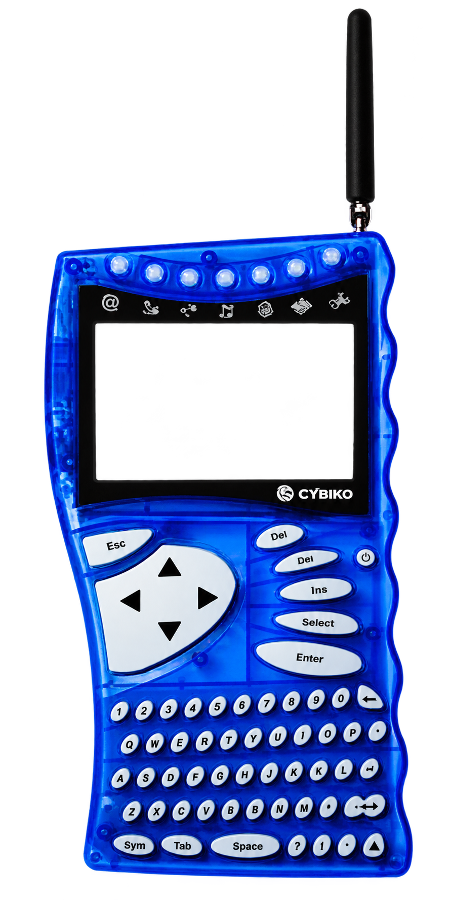

<p align="center">
  
</p>

<h1 align="center">Cybiko</h1>

<p align="center"><em>The original pocket computer. Still on the air.</em></p>

<p align="center">
  <strong>v1.1026.1b (beta)</strong> · October 2026 ·
  <a href="https://github.com/RetroCodeRamen/cybiko/releases/tag/v1.1026.1b">Linux &amp; Windows builds</a>
</p>

<p align="center">
  
</p>

---

In 2001 you could buy a little blue handheld with a real OS, a tiny keyboard, and a radio that talked to the kid across the cafeteria. No account. No tower. Just CyOS and whoever was in range.

This project does not recreate that vibe in a web app. **It boots the original CyOS.** Hitachi H8S, AT45 flash, the same keyboard matrix, the same chat — on a LilyGO T-Deck in your bag, or as a borderless Classic on your desktop with a Heltec as the radio dongle. LoRa is the transport under the old Cybiko radio, not a new protocol pretending to be one.

> Original guest. Modern hardware. Same cafeteria energy, slightly better RSSI.

**Beta.** Testers welcome. Not a 1.0. ROM images are not in the download — you bring your own. They show up on the Internet Archive more often than you'd think: [archive.org/details/cybiko](https://archive.org/details/cybiko). See [GETTING-ROMS.txt](GETTING-ROMS.txt).

---

## Get it

**[v1.1026.1b release](https://github.com/RetroCodeRamen/cybiko/releases/tag/v1.1026.1b)** — PC Classic emulator, no compiler.

| File | What |
| --- | --- |
| `cybiko-v1.1026.1b-linux-x64.zip` | Linux (`libsdl2`, `libpng`, X11) |
| `cybiko-v1.1026.1b-windows-x64.zip` | Windows (SDL2 bundled) |

Drop Classic dumps in `roms/boot.bin` (32 KB boot ROM) and `roms/flash.bin` (CyOS 1.2.46), then `./run.sh` or `run.bat`.

Plug in a **Heltec WiFi LoRa 32 V3**. The emulator finds the CP2102 on its own. Right-click the device for Settings: shell color, 4× LCD zoom, always-on-top, and flash buttons for the Heltec radio firmware and a LilyGO T-Deck (those still want [PlatformIO](https://platformio.org/) and this source tree).

### From a git checkout

```bash
# Linux
cybiko-lilygo/tools/v1_emu.sh roms/cyrom112.bin roms/flash_v1246.bin

# T-Deck Classic firmware
pio run -t upload --project-dir cybiko-lilygo -e T-Deck-Cybiko-V1

# Heltec USB LoRa modem
pio run -t upload --project-dir cybiko-heltec-modem
```

Omit `--radio` and the PC side attaches the first Heltec it sees.

---

## What you actually get

| Piece | Role |
| --- | --- |
| **PC Classic** | Borderless photo shell, original CyOS 1.2.46, Heltec as the air interface |
| **T-Deck** | Handheld that *is* the Cybiko — keyboard, LCD, trackball, LoRa, battery |
| **Heltec V3** | USB SLIP modem so the PC can share the same 915 MHz channel |

The guest is unmodified CyOS. This is not a Cybiko-style rewrite. Design notes live in [ARCHITECTURE.md](ARCHITECTURE.md); the work order is [PLAN.md](PLAN.md) (Xtreme) and [PLAN-V1.md](PLAN-V1.md) (Classic).

---

## Status

Honest snapshot, 23 Oct 2026.

| Have today | Still cooking |
| --- | --- |
| PC Classic shell on Linux and Windows | One-click flash pack with no PlatformIO |
| Heltec auto-detect + CyRadio OLED | CyOS app loader from the PC |
| T-Deck Classic firmware | XT battery on Port A |
| PC ↔ T-Deck LoRa beacons / Nearby | Native Windows click-through window shape |

A passing `make test` is not a hardware result. A LoRa ping is not CyOS chat. Both of those have happened here; chat over the air is the thing we keep chasing.

---

## Card layout (T-Deck)

| Path | Role |
| --- | --- |
| `/cybiko/boot.bin` | XT boot ROM (`cyrom150.bin`, 32 KB) |
| `/cybiko/flash.bin` | CyOS 1.5.08 (`cyos_v1508.bin`, 512 KB) |
| `/cybiko/save.nvram` | Guest RAM image, written back every few minutes |
| `/cybiko/apps/*.app` | Injected into that save before boot if the name is new |
| `/cybiko-v1/boot.bin` | Classic boot ROM (`cyrom112.bin`) |
| `/cybiko-v1/flash.bin` | CyOS 1.2.46 (`flash_v1246.bin`) |
| `/cybiko-v1/save.flash` | AT45DB041 image |

ROMs and `.app` files stay off git on purpose.

---

## What's in the tree

| Path | Role |
| --- | --- |
| `cybiko-c-emulator` | H8S core, host tests, radio codec, `two_boot` |
| `cybiko-lilygo` | T-Deck firmware (XT default, Classic env) and the PC `v1_emu` |
| `cybiko-heltec-modem` | Heltec V3 USB LoRa modem |

```bash
make -C cybiko-c-emulator test
```

Dan Berkowitz's Java emulator is a local reference for radio and SCI behavior. It is not in this repo.
